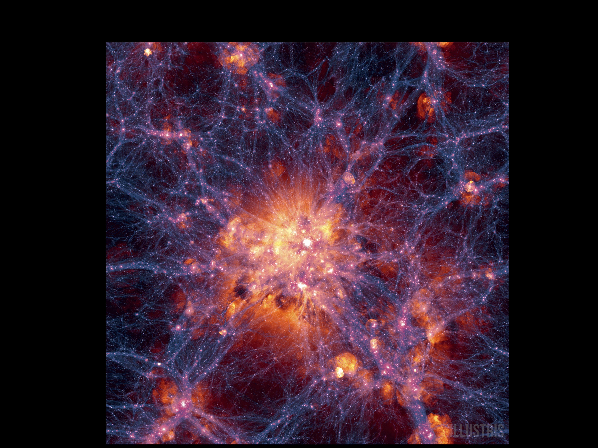
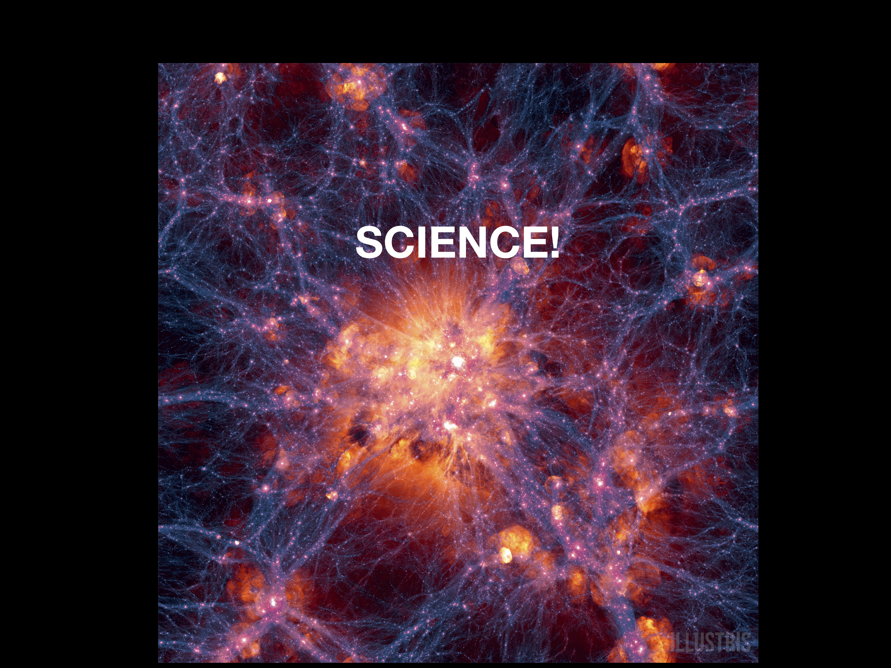
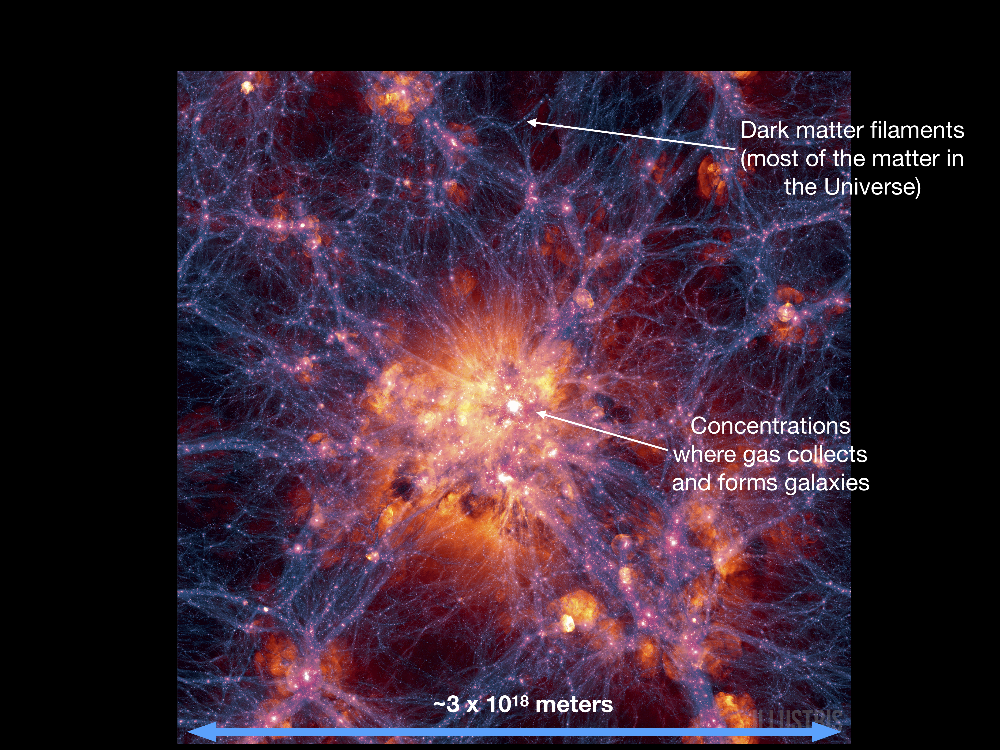
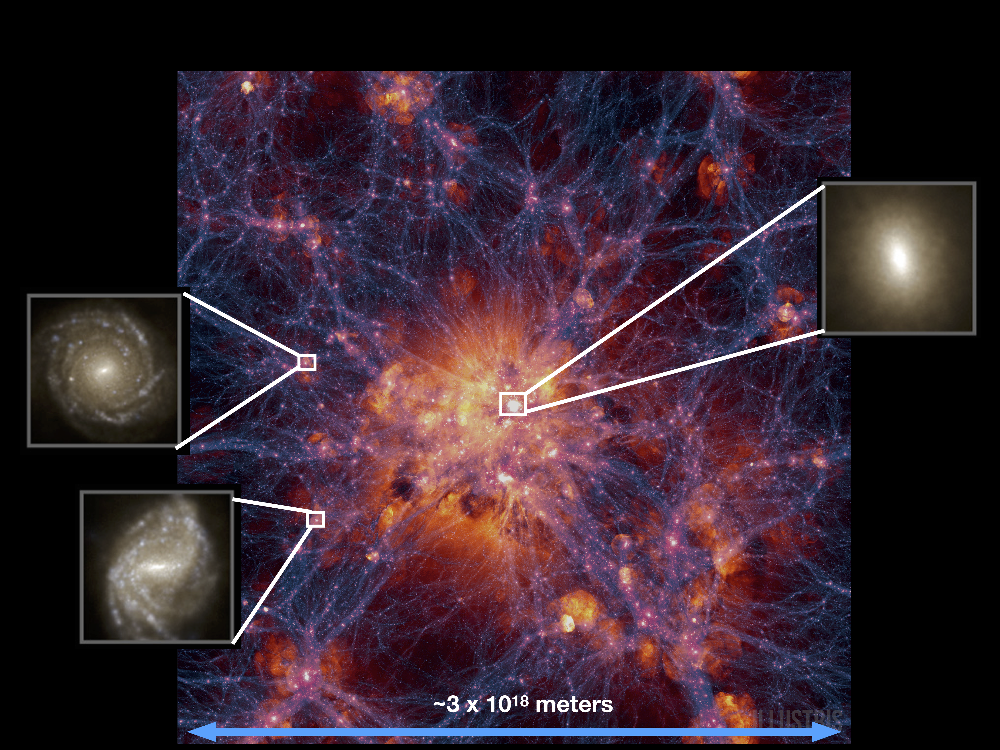
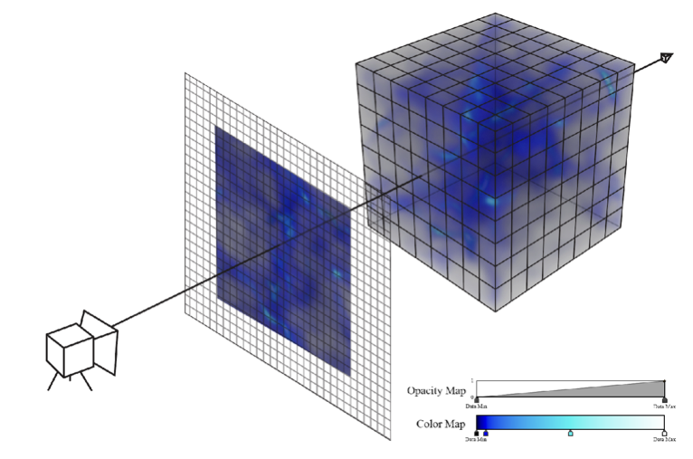
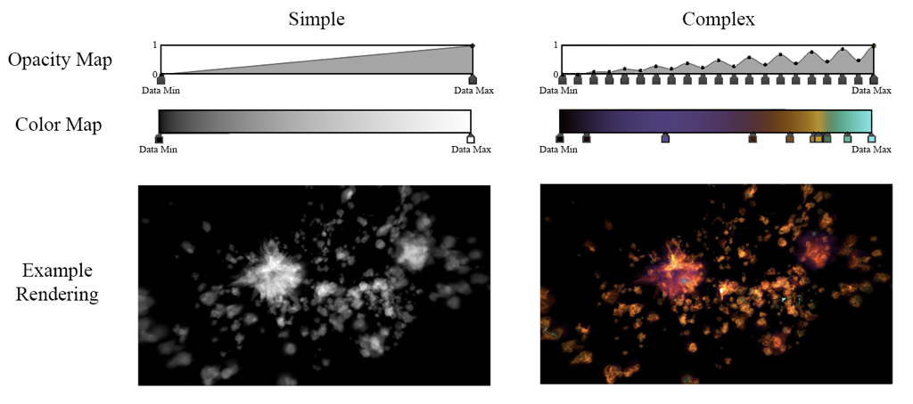
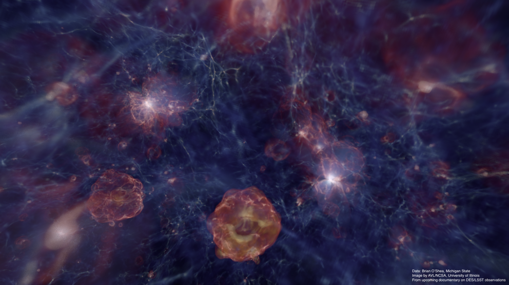
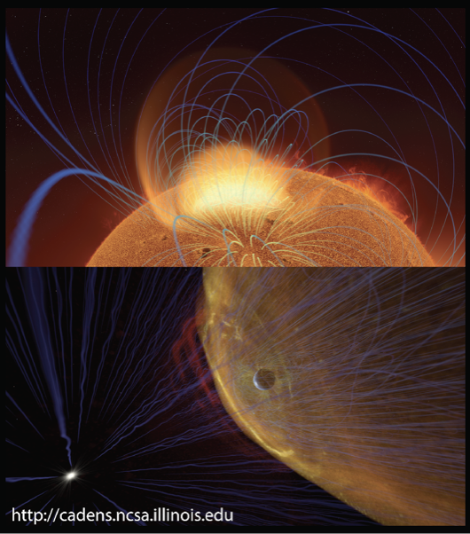

   
# Welcome to this PowerBI Workshop!

notes:
just a few items before we get into the workshop as far as bureaucratic items and a bit about me!

---

## How to access the workshop website/slides

Workshop webpage: [COURSE_WEBPAGE/](COURSE_WEBPAGE/)

notes:
**make sure this is accessible on the web!**

---

## How to translate these slides

[Google Translate for Webpages](https://translate.google.com/?sl=auto&tl=en&op=websites)

notes:

So you all might be more adept at doing this than I, but a few pointers just in case!

**put in the URL for these slides, starting from main webpage**

**show that if you click on slides, some of the formatting is gone and you might need to play with the zoom**

**check in with folks**

---

## The course webpage

[The syllabus](COURSE_WEBPAGE/syllabus) covers more than we'll probably get to!

notes:
**go over this**

**highlight**:
1. where more reading is
2. where videos are -- if folks want to look over these materials again (and more!)

---

## The course webpage

[The syllabus](COURSE_WEBPAGE/syllabus) covers more than we'll probably get to!

Each Module on the [main course webpage](COURSE_WEBPAGE/) contains lecture slides, links to resources or data or various forms of the "walkthroughs" we'll be going over.

notes:
**go over this too**

**highlight:**
1. lecture slides
2. resources/data
3. walkthroughs -- point out PDF versions have slightly nicer formatting, the HTML is translatable

**pause for questions**

---

### My background

---

### My background

---

### My background

---

### My background

---

### My background

---

### My background
#### ytini.com

Naiman et al. 2017, Borkiewicz et al. 2018

---

### My background
#### ytini.com

Naiman et al. 2017, Borkiewicz et al. 2018

---

### My background
#### ytini.com

Naiman et al. 2017, Borkiewicz et al. 2018

---

### My background
#### ytini.com

Naiman et al. 2017, Borkiewicz et al. 2018

---

### My background
#### Scientific Digitization

Naiman et al. 2022, TPDL conference

notes:
also do some science digitization, i.e. trying to turn scans of old scientific figures back into data by having computers "read" objects and axis labels using image processing, optical character recognition and machine learning methods

---

## Double check Excel installed?

notes:
hopefully folks got this settled, this is technically in the Lecture 1.0 slides, but I'm assuming everybody is good to go with that?

